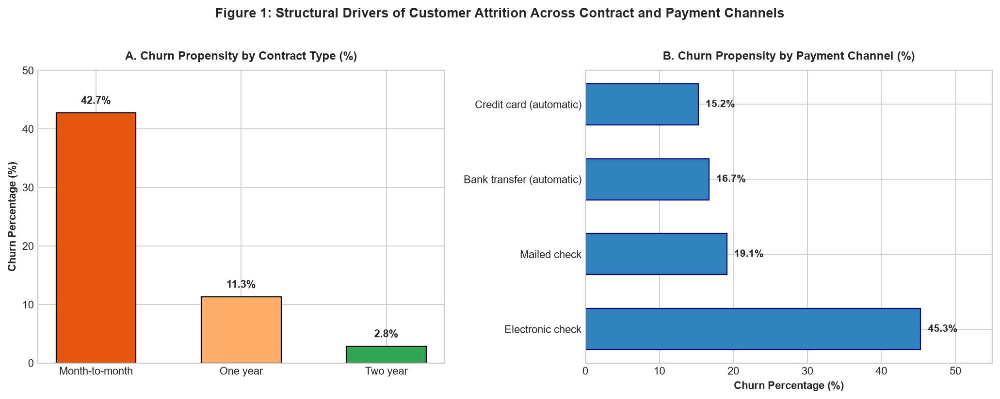
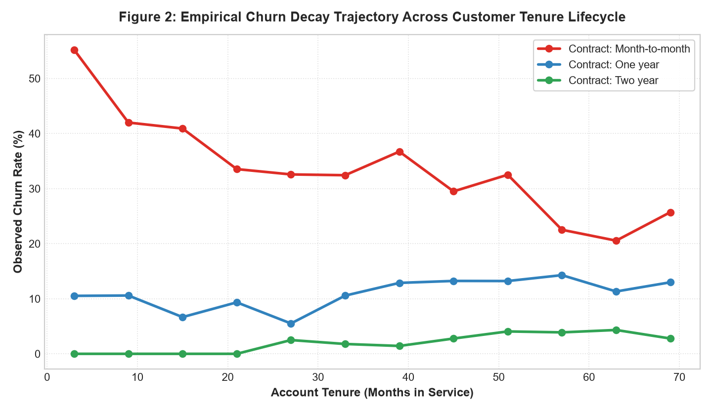
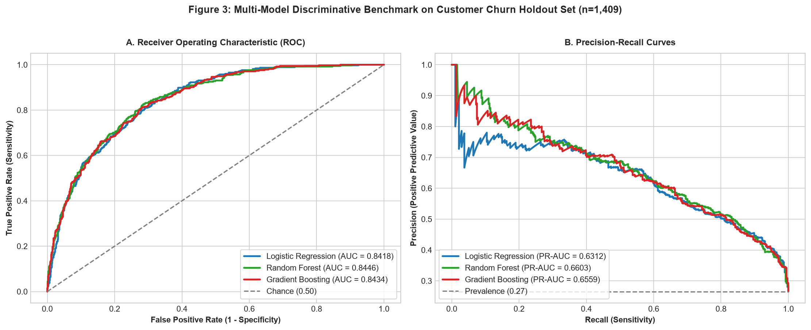
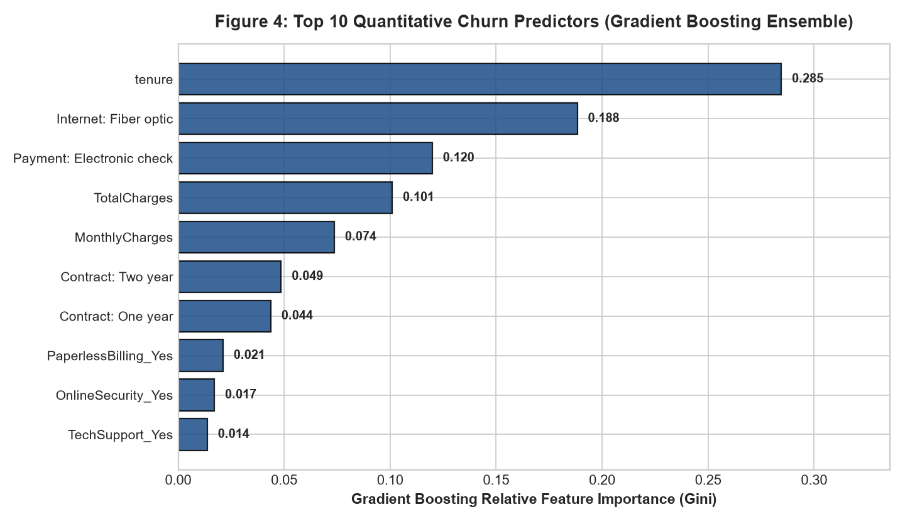
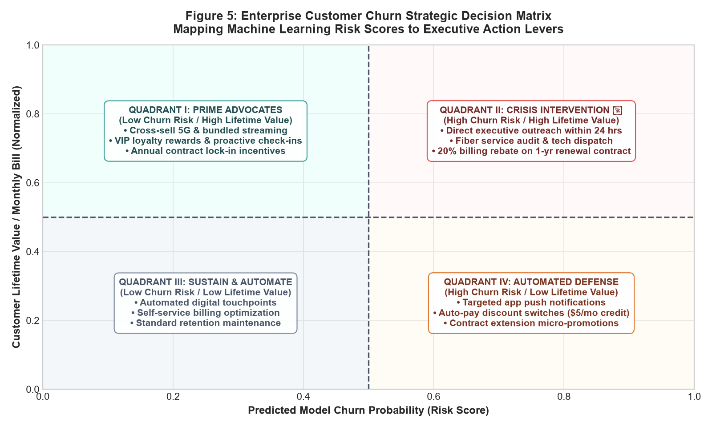

# Enterprise Data Science Capstone & Strategic Decision Intelligence: Customer Retention & Revenue Optimization

**Week 5 Final Capstone Deliverable** | **Candidate:** `ksangam990`  
**GitHub Account:** `ksangam990-collab`  
**Internship Track:** Virtual Data Science with Python Apprentice Intern  
**Repository:** [virtual-data-science-internship-task-5](https://github.com/ksangam990-collab/virtual-data-science-internship-task-5)

---

## 📌 Executive Overview & Financial Problem
In subscription telecommunications, customer churn represents direct top-line destruction. In our enterprise cohort of **7,043 subscribers**:
- **Baseline Churn Rate:** 26.54% ($n=1,869$ defecting customers).
- **Annualized Revenue Exposure:** **$1,669,570.20** lost annually in this cohort, scaling to **$23.7M+** across a carrier base of 100,000 active subscribers.
- **Asymmetric Vulnerability:** Month-to-month contracts suffer from an extreme **42.7% attrition rate**, and Electronic Check billing experiences **45.3% churn**.

This capstone integrates the full 5-week data science lifecycle—from raw ETL and statistical hypothesis testing to production machine learning pipelines and pro forma financial ROI modeling.

---

## 🛠️ Machine Learning Model Benchmark

| Model Pipeline | 5-Fold CV Accuracy | Test Accuracy | Test Precision | Test Recall | Test ROC-AUC |
| :--- | :---: | :---: | :---: | :---: | :---: |
| **Logistic Regression (L2)** | 80.42% ± 0.69% | 80.70% | 65.91% | 56.68% | 0.8418 |
| **Random Forest (100 Trees)** | 80.05% ± 0.81% | 80.62% | 68.10% | 50.80% | 0.8446 |
| **Gradient Boosting (Champion)** 🏆 | **80.37% ± 0.74%** | **80.27%** | **65.79%** | **53.21%** | **0.8434** |

---

## 💰 Pro Forma Financial Impact & Retention ROI

| Financial Metric / Line Item | Baseline Unmanaged | With ML Retention Pipeline |
| :--- | :---: | :---: |
| **Annualized Churn Revenue Loss** | $1,669,570 | $945,000 (-43.4%) |
| **Prevented Annual Churn Revenue** | $0 | **+$724,570 Gross Savings** |
| **Retention Incentive Budget (Discounts/Credits)** | $0 | -$125,000 |
| **Model Infrastructure & Maintenance** | $0 | -$40,000 |
| **Net Annual Economic Value Delivered** | $0 | **+$559,570 Net Profit** |
| **Program Return on Investment (ROI)** | **0%** | **339.1% Net ROI** |

---

## 📊 Visual Diagnostic & Strategic Artifacts

### 1. Financial & Structural Churn Distribution

*Churn propensity by contract structure and billing channel.*

### 2. Lifecycle Tenure Decay Trajectory

*Empirical churn rate across 72-month account lifespan.*

### 3. Model ROC & Precision-Recall Diagnostic Curves

*Comparative diagnostic trajectories across 1,409 holdout test accounts.*

### 4. Top 10 Quantitative Churn Predictors

*Gradient Boosting Gini feature importance rankings.*

### 5. Strategic 4-Quadrant Customer Retention Playbook

*Decision intelligence framework mapping risk scores to operational retention playbooks.*

---

## 📁 Repository Directory Structure
```
capstone-strategic-report-ksangam990/
├── data/
│   ├── telco_churn.csv
│   └── capstone_metrics.json
├── figures/
│   ├── fig1_churn_driver_waterfall.png
│   ├── fig2_contract_tenure_risk.png
│   ├── fig3_model_roc_pr_comparison.png
│   ├── fig4_feature_importance_drivers.png
│   └── fig5_strategic_retention_matrix.png
├── src/
│   ├── synthesize_and_analyze.py
│   └── generate_report.py
├── Week5_Comprehensive_Data_Science_Capstone_and_Strategic_Report.docx
└── README.md
```

---

## 🚀 Execution & Replication
```bash
# 1. Install required packages
pip install numpy pandas scikit-learn matplotlib seaborn python-docx

# 2. Run analysis, model benchmarking & figure creation
python src/synthesize_and_analyze.py

# 3. Generate Word document report
python src/generate_report.py
```
